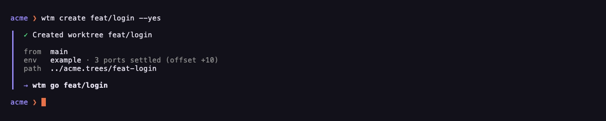
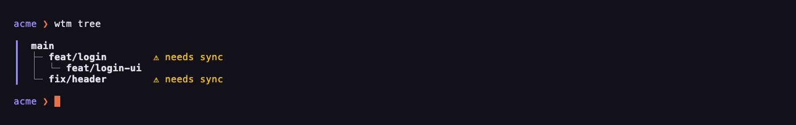
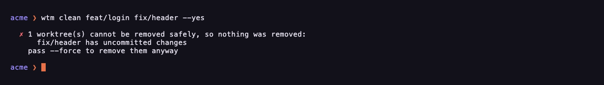

<p align="center">
  <picture>
    <source media="(prefers-color-scheme: dark)" srcset="docs/assets/banner-dark.svg">
    
  </picture>
</p>

<p align="center">A git worktree manager that gives each branch its own ports, Compose project, database and URL, so you and your coding agents can run several branches side by side.</p>

<p align="center">
  <a href="https://github.com/LucasPcq/wtm/releases/latest"></a>
  <a href="https://wtm.sh/docs/"></a>
  <a href="LICENSE"></a>
</p>

<p align="center">
  <a href="https://wtm.sh/docs/">Docs</a> · <a href="docs/guide/installation.md">Install</a> · <a href="docs/guide/README.md">Guide</a> · <a href="CHANGELOG.md">Changelog</a>
</p>

<p align="center">
  <br>
  <em>One command for a worktree, one for its stack.</em>
</p>

## Highlights

- **A worktree per branch, ready to code:** `.env` files copied and your hooks run, from any base.
- **Its own stack:** shifted ports, its own Compose project and database, a named URL.
- **Stacked branches stay in order:** a whole chain rebased onto its parents in one command.
- **Gone once merged:** never with uncommitted, unpushed or open work.
- **Configured once, run by everyone:** one person writes `run.toml`, the team imports it.
- **Built for agents:** a skill, `--output json`, `--yes`, a live event stream.

## Install

```bash
brew install LucasPcq/tap/wtm
echo 'eval "$(wtm shell-init)"' >> ~/.zshrc
```

macOS, Linux and WSL2. Other ways to install, and a specific version: [Installation](docs/guide/installation.md). Then `wtm init` once in your repository, or follow [Getting started](docs/guide/getting-started.md).

## The life of a branch

### Created, ready to code

A worktree from any base, its `.env` files copied and your `on_create` hooks run.

```bash
wtm create feat/login
```



### Running, each with its own stack

Its own ports, Compose project, database and URL. An agent starts the whole app in its worktree and checks its own work while yours keeps running. One person writes the [`run.toml`](docs/guide/run-toml.md) that describes the stack, the team imports it.

```bash
wtm run up
```


### Kept in order

Every worktree knows the branch it came from. When `main` moves, the whole chain is rebased, parents first.

```bash
wtm sync --all
```



### Gone once merged

Every worktree whose pull request merged, removed with its jobs and its data. Uncommitted, unpushed or open work is refused until `--force`.

```bash
wtm prune
```



## Built for agents

Every change takes `--yes`, every data command `--output json`, and `wtm events` streams what every shell and agent does. One command teaches your agent the rest:

```bash
wtm agents install
```

[Integrations](docs/guide/integrations.md) · [The event stream](docs/guide/events.md) · [herdr-wtm](https://github.com/LucasPcq/herdr-wtm)

## Learn more

[Getting started](docs/guide/getting-started.md) · [Guide](docs/guide/README.md) · [Commands](docs/wtm.md) · [Compared to](docs/guide/compared.md) · [Changelog](CHANGELOG.md) · [Contributing](CONTRIBUTING.md)

MIT licensed.
